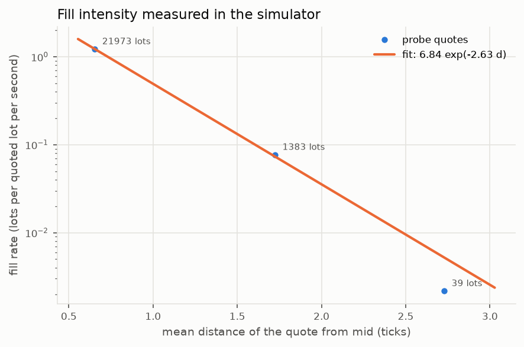
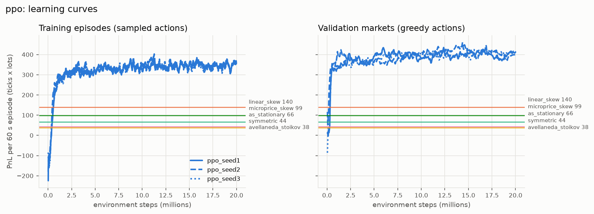
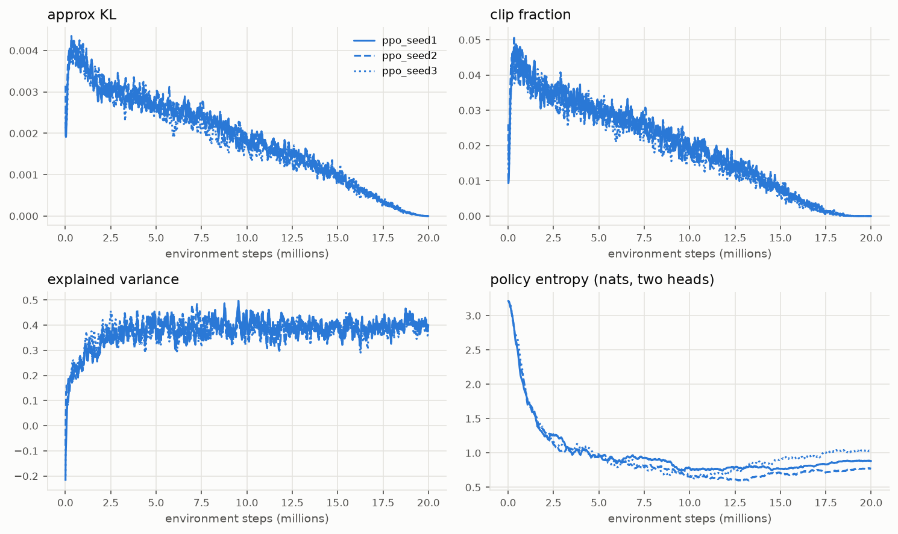
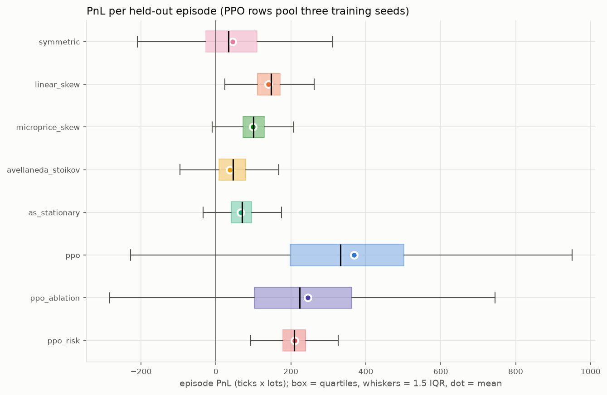
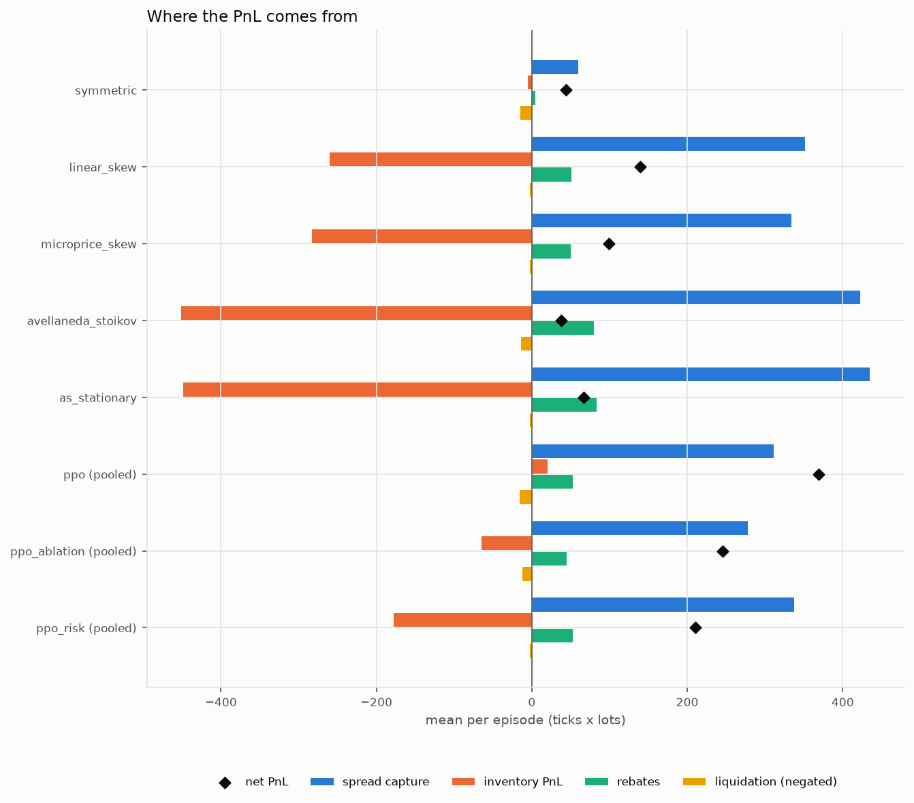
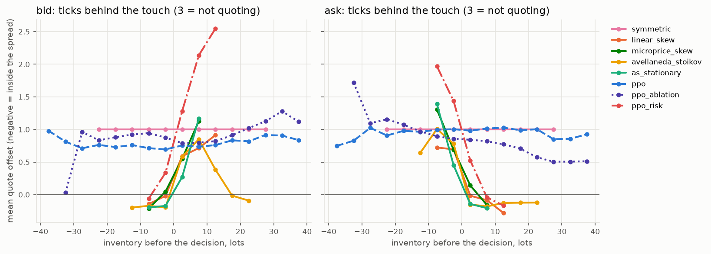
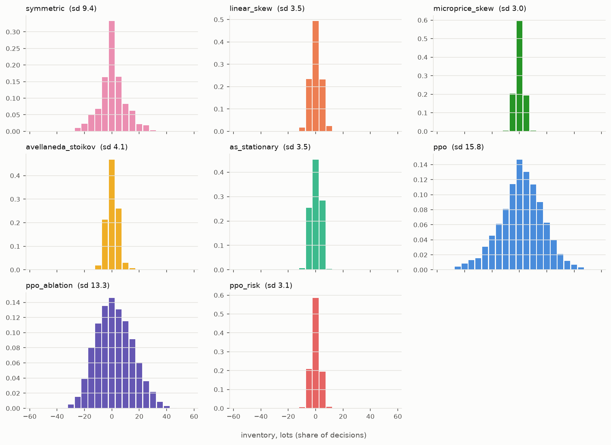
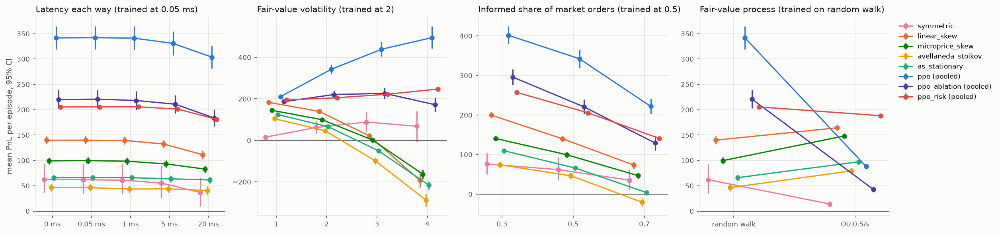

<p align="center">
  
</p>

# rl-market-maker

A PPO market maker trained in a limit order book simulator with queue position and latency, compared on held-out markets against Avellaneda-Stoikov and simpler quoting rules.

I've worked around market making, and a lot of the RL market-making work I've read reports an agent beating Avellaneda-Stoikov in a simulator where a passive order fills whenever the price touches it, with no queue and no latency. I wanted to know whether an agent trained in something closer to a real venue learns anything beyond what the closed-form models already say, or whether it just finds the quirks of its simulator. So I built one on top of my [lob](https://github.com/PDiTO/lob) matching engine, wrote PPO from scratch, calibrated the baselines to the same simulator, and measured all of them on markets none of them had seen.

Short version of what I found:

- In this simulator PPO beats every baseline by a lot. Averaged over three training seeds it makes 369 ticks x lots per 60-second session on 500 held-out markets, against 140 for the best hand-written rule (a linear inventory skew) and 38 and 66 for the two Avellaneda-Stoikov variants. The paired difference against linear skew is +230 [+210, +250].
- Most of that edge is trend following. The generator's mid lags a random-walk fair value, so recent returns predict the next move. The agent learned to quote only on the side the price is moving toward and to carry inventory in the direction of the trend. Its fills show no adverse selection at five seconds, while linear skew and both AS variants lose about half a tick per lot. It also carries four times the inventory and has worse risk-adjusted returns than linear skew. When I made the fair value mean-reverting, which removes the trend, its PnL fell from 342 to 88, below linear skew's 164.
- A risk-averse reward (ten times the inventory penalty plus asymmetric dampening) gave an agent that earns less (210) but beats linear skew on PnL and on every risk measure I have: +70 [+66, +75] PnL, lower PnL dispersion, 1.6 times the Sharpe ratio, half the drawdown. It was also the only agent that still beat linear skew with a mean-reverting fair value (188 against 164).
- Classical Avellaneda-Stoikov does badly here, and the stationary version only a little better. Both put their unwind quote inside the spread when they hold inventory. That buys a lot of fills, and those fills are the most adversely selected of any strategy.

So the answer to my question is "some of both", and the ablations and stress tests below show which part is which.

## Contents

- [Quickstart](#quickstart)
- [How it sits on top of lob](#how-it-sits-on-top-of-lob)
- [The environment](#the-environment)
- [PPO](#ppo)
- [Baselines and calibration](#baselines-and-calibration)
- [Training](#training)
- [Results](#results)
- [What the agent actually learned](#what-the-agent-actually-learned)
- [Out-of-regime stress tests](#out-of-regime-stress-tests)
- [Is this skill or a simulator quirk?](#is-this-skill-or-a-simulator-quirk)
- [Limitations](#limitations)
- [Tests](#tests)
- [Layout](#layout)

## Quickstart

You need [uv](https://docs.astral.sh/uv/) and a Rust toolchain, because `uv sync` builds the simulator from source with maturin. The simulator is a sibling checkout:

```sh
git clone https://github.com/PDiTO/lob
git clone <this repo> rl-market-maker
cd rl-market-maker
uv sync                  # builds ../lob and installs torch, gymnasium, numpy, matplotlib
uv run pytest            # 66 tests, a few seconds on a laptop CPU
```

The dependency on lob is a uv path source. To use the GitHub repo instead of a sibling checkout, change one line in `pyproject.toml`:

```toml
lob = { path = "../lob", package = true }   # now
lob = { git = "https://github.com/PDiTO/lob" }   # instead
```

`package = true` is only there because lob's own `pyproject.toml` marks it as a virtual project for its development workflow. uv builds a git source as a package anyway.

Reproducing everything:

```sh
uv run rlmm train --config configs/ppo.toml            # 3 seeds, 20M steps each
uv run rlmm train --config configs/ppo_ablation.toml   # the ablation, 3 more seeds
uv run rlmm train --config configs/ppo_risk.toml       # risk-averse reward, 3 more seeds
uv run rlmm calibrate --config configs/eval.toml       # sigma, A, k, baseline tuning
uv run rlmm eval --config configs/eval.toml            # held-out comparison and stress tests
uv run rlmm plot --config configs/eval.toml            # figures into results/figures
```

`rlmm train --seed 2` trains a single seed, which is how I ran the seeds in parallel. Using the environment directly:

```python
import numpy as np
from rlmm.env import EnvConfig, LobMarketMakingEnv

env = LobMarketMakingEnv(EnvConfig(horizon_s=60.0))
obs, info = env.reset(seed=0)
obs, reward, terminated, truncated, info = env.step(np.array([2, 2]))  # join both sides
```

One trained policy is committed, the risk-averse agent from seed 1, in `results/policy/ppo_risk_seed1.pt` (170 KB). `rlmm.ppo.Agent.load` reads it. The other checkpoints stay out of git; `rlmm train` recreates them.

## How it sits on top of lob

lob gives me three things through its Python bindings: `lob.OrderBook`, the price-time matching engine; `lob.generate_feed`, the synthetic order-by-order market; and `lob.run_backtest`, an event-driven backtester with order-entry and market-data latency.

The gap is that `run_backtest` owns its event loop. It runs the whole feed and calls a Python strategy back on timers and market data. An RL environment needs the opposite: the caller decides when the simulation advances, one decision at a time. There's also no way to see your own queue position through the strategy context, which only exposes L2.

I didn't want to fork lob, so `rlmm.sim.ReplayEngine` re-implements the backtester's loop in Python on top of `lob.OrderBook` and `lob.generate_feed`, with the same rules:

- feed messages reach the exchange at their own timestamps, our orders `order_latency_ns` after we send them;
- we see public data and our own acks and fills `market_data_latency_ns` after the exchange produced them;
- ties go to the feed first, then everything else in the order it was scheduled;
- accounting is lob's exact integer micro-tick scheme with average-cost realized PnL, ported line for line (including Rust's truncating integer division).

The part I care most about is that it's tested against the real thing. `tests/test_engine.py` runs the same quoting logic twice, once as a Python strategy inside `lob.run_backtest` and once on the replay engine, under five latency settings, and requires every fill (time, order id, side, price, size, mid before) and the final cash, position, fees and realized PnL to match exactly. They do.

On top of lob's semantics the engine tracks the exact queue position of each of our resting orders, meaning lots ahead of it at its price. It updates that from the matching events rather than by scanning L3, which costs about 75 microseconds per call through the bindings. A test checks the incremental number against a full L3 recount at every decision. The whole environment runs at roughly 20,000 steps a second on one core.

## The environment

`LobMarketMakingEnv` is a Gymnasium environment. One step is 100 ms of market time. An episode is a 60-second session, so 600 decisions, after a 5-second warm-up so the book is in steady state. Each episode gets a fresh synthetic market from a seed, and everything is deterministic given `reset(seed=...)`. Training, calibration and evaluation draw their market seeds from disjoint ranges.

The market is lob's default synthetic market: Poisson limit orders around a latent fair value that follows a random walk with volatility 2 ticks per square-root second, 10 market orders a second of which half are informed (they trade toward fair value), and per-order cancels. Latency is 50 microseconds each way, the maker rebate 0.1 ticks per lot and the taker fee 0.3. Our orders always join the back of their queue.

### Observation

Everything the agent sees is what a real system would know at that moment: the book as of market-data latency ago, and its own position and orders rebuilt only from acks and fills that have arrived. 24 features, each clipped to a fixed range:

| group | features |
|---|---|
| own state | inventory / max position, share of the session left |
| book | spread, top-of-book imbalance, five-level imbalance, microprice minus mid |
| recent prices | mid change over the last 1, 10 and 50 steps, EWMA volatility of 1-step changes |
| trade flow | aggressor imbalance and log volume over the last step |
| own quotes, per side | quoting or not, ticks behind the touch, log of lots ahead in the queue, share of the level ahead, open size |
| own fills | lots bought and sold in the last step |

Queue position is in there because it's the thing a real market maker watches and a touch-fill simulator can't represent. An order at the back of a 40-lot queue and one at the front of a 3-lot queue at the same price are very different bets.

### Action

`MultiDiscrete([5, 5])`: one choice per side from {no quote, one tick inside the touch, at the touch, one tick behind, two ticks behind}, at a fixed size of 5 lots. "Inside" joins the touch when the spread is one tick, since it would otherwise cross.

I went with discrete levels relative to the touch rather than continuous offsets from mid for three reasons. The tick is coarse here (the spread is one tick about two thirds of the time), so continuous offsets would be rounded onto the same handful of prices anyway. Levels relative to the touch map directly onto queue decisions: stay where you are, rejoin the back of the touch, or step away. And two small categorical heads are easy for PPO; skew falls out of choosing the two sides differently. I left size fixed. With a hard inventory cap and an inventory penalty, size mostly scales PnL and risk together, and adding it would square the action space.

An order already resting at the chosen price is left alone, so the agent keeps its queue place by choosing the same level again. Anything else is cancelled and replaced with a post-only order at the back of the new queue. A side is not quoted if a fill would take the known position past 50 lots. That limit uses the delayed position, so in-flight fills can overshoot by one quote, as they could on a real venue.

### Reward

$$
r_t = \Delta \mathrm{PnL}_t \;-\; \phi\, q_t^2\, \Delta t \;-\; \eta \max\!\left(0,\; q_{t-1}\, \Delta m_t\right) \;-\; \mathbb{1}[t = T]\; C_{\mathrm{liq}}(q_T)
$$

- $\Delta \mathrm{PnL}_t$ is the change in mark-to-market PnL at the exchange mid, including rebates, from the simulator's own accounting.
- $\phi q^2 \Delta t$ is a running quadratic inventory penalty, the discrete form of the $\phi \int q^2\,dt$ term in Cartea and Jaimungal's formulation. The base run uses $\phi = 0.005$ ticks per lot squared per second.
- The $\eta$ term is asymmetric dampening (Spooner et al., 2018). It removes a share of the gains that came from the mid moving in favour of the inventory, but none of the losses, which discourages the agent from speculating with inventory. It is off in the base run and set to $\eta = 0.5$ in the risk-averse run.
- $C_{\mathrm{liq}}$ is the cost of flattening the final position with a market order against the visible book at the end, measured from mid and including the taker fee.

Since time left is in the observation, the end of a session is a true terminal state, not a truncation.

## PPO

PPO is written out in `src/rlmm/ppo/`, with no RL library. For a batch of transitions with probability ratio $\rho_t(\theta) = \pi_\theta(a_t \mid s_t) / \pi_{\theta_{\mathrm{old}}}(a_t \mid s_t)$ and advantage estimate $\hat A_t$, the loss minimised is

$$
L(\theta) = -\,\mathbb{E}_t\!\left[\min\!\big(\rho_t \hat A_t,\; \mathrm{clip}(\rho_t, 1-\epsilon, 1+\epsilon)\, \hat A_t\big)\right] \;+\; c_v\, L^V(\theta) \;-\; c_e\, \mathbb{E}_t\!\left[\mathcal{H}\big(\pi_\theta(\cdot \mid s_t)\big)\right]
$$

with the value loss optionally clipped,

$$
L^V = \tfrac12\, \mathbb{E}_t\!\left[\max\!\Big(\big(V_\theta(s_t) - R_t\big)^2,\; \big(V_{\mathrm{old}}(s_t) + \mathrm{clip}(V_\theta(s_t) - V_{\mathrm{old}}(s_t), -\epsilon_v, \epsilon_v) - R_t\big)^2\Big)\right],
$$

and advantages from GAE($\lambda$), where termination and truncation are handled differently:

$$
\delta_t = r_t + \gamma\,(1 - d^{\mathrm{term}}_t)\, V(s_{t+1}) - V(s_t), \qquad
\hat A_t = \delta_t + \gamma \lambda\, (1 - d^{\mathrm{end}}_t)\, \hat A_{t+1}, \qquad R_t = \hat A_t + V(s_t).
$$

On a truncation, $V(s_{t+1})$ is the value of the final observation, not of the reset observation that replaced it. The vector env returns final observations separately for exactly this.

The rest of the standard recipe (Huang et al., "The 37 implementation details of PPO", is a good checklist):

- 16 synchronous environments with same-step autoreset;
- separate policy and value MLPs, 2 x 128 tanh, orthogonal init, policy head at gain 0.01 so it starts near uniform;
- a factorised categorical policy, one head per side, log-probabilities and entropies summed;
- running mean and variance normalisation of observations (Chan et al.'s parallel update) and scaling of rewards by the running std of the discounted return;
- per-minibatch advantage normalisation, minibatch epochs, global gradient-norm clipping, Adam with linear learning-rate annealing;
- logging of approximate KL ($\mathbb{E}[(\rho - 1) - \log \rho]$), clip fraction, explained variance, entropy and gradient norm, plus a validation run of the greedy policy on 16 fixed markets every 5 updates.

| setting | value |
|---|---|
| steps per seed | 20M (2,441 updates of 8,192) |
| rollout | 16 envs x 512 steps |
| minibatches x epochs | 8 x 5 |
| learning rate | 3e-4, annealed to 0 |
| $\gamma$, $\lambda$ | 0.99, 0.95 |
| clip $\epsilon$ | 0.2 (value clipping off) |
| entropy, value coefficients | 0.005, 0.5 |
| max gradient norm | 0.5 |

## Baselines and calibration

### Avellaneda-Stoikov

In Avellaneda and Stoikov (2008), the mid follows $dS = \sigma\, dW$, the market maker maximises CARA utility of terminal wealth with risk aversion $\gamma$, and a quote at distance $\delta$ from the mid fills at Poisson rate $\lambda(\delta) = A e^{-k\delta}$. The approximate solution is a reservation price and a spread around it:

$$
r_t = s_t - q_t\, \gamma \sigma^2 (T - t), \qquad
\delta^a_t + \delta^b_t = \gamma \sigma^2 (T - t) + \frac{2}{\gamma} \ln\!\left(1 + \frac{\gamma}{k}\right).
$$

The skew per lot, $\gamma\sigma^2(T-t)$, is largest at the start of a session and vanishes at the end. Guéant, Lehalle and Fernandez-Tapia (2013) give the long-horizon limit, where the quotes stop depending on $T - t$:

$$
\delta^b(q) = c_1 + \frac{2q + 1}{2} c_2, \qquad \delta^a(q) = c_1 - \frac{2q - 1}{2} c_2, \qquad
c_1 = \frac{1}{\gamma}\ln\!\left(1 + \frac{\gamma}{k}\right), \quad
c_2 = \sqrt{\frac{\sigma^2 \gamma}{2kA}\left(1 + \frac{\gamma}{k}\right)^{1 + k/\gamma}}.
$$

I run both: `avellaneda_stoikov` on the 60-second session horizon, and `as_stationary` with the constant skew. Model prices are rounded to the nearest tick, ties to the passive side, and kept from crossing the visible touch because the orders are post-only.

### Two simpler rules

- `symmetric` quotes a fixed number of ticks behind the best bid and ask whatever the inventory.
- `linear_skew` quotes half a tick either side of $m - \kappa q$, which joins the touch when flat and backs off the side that would add to inventory. `microprice_skew` is the same rule centred on the size-weighted microprice instead of the mid, which is the simplest way to give a hand-written quoter the book-imbalance signal the agent can see.

### Calibration

All calibration runs on its own range of market seeds (`rlmm calibrate`, output in `results/calibration.json`).

**Volatility.** The realised volatility of the exchange mid depends on the horizon you measure it at:

| horizon | 0.1 s | 1 s | 5 s | 10 s |
|---|---|---|---|---|
| $\hat\sigma$, ticks per $\sqrt{\mathrm{s}}$ | 1.23 | 1.35 | 1.80 | 1.96 |

The generator's fair value moves at 2.0. The mid is much quieter at short horizons because it lags the fair value and only moves in whole ticks, and the rising ratio is positive autocorrelation: moves continue. That will matter later. AS assumes a diffusive mid, so I use the 5-second figure, $\sigma = 1.80$.

**Fill intensity.** I didn't want to estimate $A$ and $k$ from trade prints, because that ignores the queue: a print at your price doesn't mean you got filled. Instead a probe strategy quotes a fixed number of ticks behind the touch on both sides, in the full simulator, across 30 markets per level, and I measure the fill rate in lots per quoted lot per second against the time-averaged distance of the quote from the mid:

| ticks behind the touch | mean distance from mid | fill rate | lots filled |
|---|---|---|---|
| 0 | 0.65 | 1.22 | 21,973 |
| 1 | 1.72 | 0.077 | 1,383 |
| 2 | 2.73 | 0.0022 | 39 |
| 3 | 3.73 | 0 | 0 |

A weighted least-squares fit of $\log \lambda = \log A - k\delta$ (weights equal to the fill counts, since the variance of a log Poisson rate is about one over the count) gives $A = 6.84$ and $k = 2.63$ per tick.



**Tuning.** Each baseline has one free parameter, which I picked by grid search on 200 calibration markets using mean training reward, the same objective the agent optimises. Mean PnL per session at each grid point, with the chosen value in bold:

| baseline | parameter | mean PnL by value |
|---|---|---|
| symmetric | ticks behind the touch | 0: -8, **1: 42**, 2: 4 |
| linear skew | $\kappa$, ticks per lot | 0: -30, 0.01: 136, 0.03: 137, 0.05: 138, **0.07: 138**, 0.1: 132, 0.2: 105, 0.5: 50 |
| microprice skew | $\kappa$ | 0: -278, 0.05: 17, 0.1: 77, 0.15: 91, **0.2: 96**, 0.3: 86, 0.5: 66 |
| AS | $\gamma$ | 0.0003: -56, 0.001: 17, 0.002: 39, **0.003: 45**, 0.005: 42, 0.01: 40, 0.05: 11 |
| AS stationary | $\gamma$ | 0.003: -22, 0.01: 11, 0.05: 56, 0.1: 68, **0.2: 70**, 0.5: 58 |

Two things stand out. Joining the touch on both sides with no inventory control loses money (the 0 rows). And linear skew is almost flat in $\kappa$ from 0.01 to 0.07. Because prices are rounded to ticks, any small positive $\kappa$ already moves the bid back a tick once you're long when the spread is one tick. What matters is that you stop adding to a position, not how hard you lean.

## Training

Nine PPO runs, all on the M4 Pro laptop's CPU, one process per run, one torch thread each, all running at the same time:

| run | config | what changes | steps per seed | wall clock per seed |
|---|---|---|---|---|
| PPO | `configs/ppo.toml` | the setup described above | 20M | 55 to 60 min |
| PPO ablation | `configs/ppo_ablation.toml` | book imbalance, microprice, recent returns and trade-flow imbalance hidden from the agent | 20M | 58 min |
| PPO risk-averse | `configs/ppo_risk.toml` | $\phi$ = 0.05 instead of 0.005, and $\eta$ = 0.5 | 10M | 32 min |

Everything started at 21:43 and the last run finished at 22:51, so about 67 minutes of wall clock for 150M environment steps. Each process ran at 5,000 to 6,000 steps a second including the PPO updates and validation, against about 12,000 in a short single-process smoke run, because nine of them shared the laptop with everything else I had open. I didn't try MPS. The networks are two small MLPs and most of the time goes into stepping the simulator in Python, so there was little for a GPU to do.



The left panel is training episodes with sampled actions, the right the greedy policy on 16 fixed validation markets. Horizontal lines are the baselines' held-out means. All three seeds pass the best baseline within about a million steps and flatten out by five million; the rest of the budget adds little. The three seeds are hard to tell apart, and on the held-out markets their means are 368, 373 and 367.



Approximate KL per update never goes above 0.006 and the clip fraction never above 7%, and both fall steadily as the learning rate anneals. Explained variance settles around 0.4. That is low, and I think it's honest: at the start of a 60-second session most of the variance in the return is price noise the value function can't see coming. Entropy drops from the uniform 3.2 nats to about 0.9, so the policy is still fairly stochastic when it samples; evaluation uses the most likely action on each side.

The other two groups have the same figures in `results/figures/` (`learning_curves_ppo_ablation.png`, `learning_curves_ppo_risk.png` and the matching diagnostics). The training logs in `results/training/` keep every fifth update, the ones with a validation score.

## Results

Every strategy ran on the same 500 held-out markets, 60 seconds each at the training latency. Their seeds come from a range never used in training, calibration or validation. PnL is in ticks x lots, net of rebates and of flattening the final position into the book. Brackets are 95% bootstrap confidence intervals for the mean. The three PPO rows pool the three training seeds (1,500 episodes each). The between-seed spread of the per-seed means is small, a standard deviation of 3.2, 2.7 and 1.6 for the three groups, so pooling doesn't hide seed luck. Full tables, including per-seed rows, are in [`results/eval_summary.md`](results/eval_summary.md) and every episode is in `results/eval_episodes.csv`.

| policy | PnL [95% CI] | PnL sd | mean / sd | Sharpe, 1 s | max drawdown | mean abs inventory | fills | markout 5 s |
|---|---|---|---|---|---|---|---|---|
| symmetric | 44.1 [30.9, 57.8] | 153.4 | 0.29 | 0.08 | 119.8 | 7.8 | 13 | +0.12 |
| linear skew | 139.7 [134.8, 144.3] | 52.5 | 2.66 | 0.45 | 29.5 | 2.8 | 156 | -0.50 |
| microprice skew | 98.7 [95.0, 102.5] | 43.0 | 2.30 | 0.38 | 26.5 | 2.3 | 143 | -0.55 |
| AS | 37.6 [32.1, 43.0] | 62.3 | 0.60 | 0.20 | 41.8 | 3.2 | 231 | -0.56 |
| AS stationary | 66.4 [62.6, 70.0] | 42.4 | 1.57 | 0.27 | 29.3 | 2.9 | 240 | -0.54 |
| PPO | **369.2** [357.7, 381.1] | 230.7 | 1.60 | 0.31 | 101.8 | 12.1 | 154 | -0.00 |
| PPO ablation | 245.6 [235.6, 256.0] | 202.5 | 1.21 | 0.24 | 107.2 | 11.2 | 138 | -0.17 |
| PPO risk-averse | 210.2 [207.9, 212.5] | **46.2** | **4.55** | **0.71** | **15.2** | 2.4 | 156 | -0.34 |

"mean / sd" is the session PnL mean over its standard deviation across markets. "Sharpe, 1 s" is the mean over std of one-second PnL changes within a session, averaged over sessions, not annualised. The markout is how far the mid moved in our favour in the five seconds after a fill, per lot; negative means adverse selection.

Paired differences, where the PPO number is the mean over the three seeds on each market:

| agent | vs linear skew | vs microprice skew | vs AS | vs AS stationary |
|---|---|---|---|---|
| PPO | +229.6 [+209.6, +250.0] | +270.5 [+249.7, +291.4] | +331.6 [+310.8, +353.1] | +302.8 [+282.9, +323.1] |
| PPO ablation | +106.0 [+89.2, +122.9] | +146.9 [+129.3, +164.7] | +208.0 [+190.4, +226.2] | +179.3 [+162.3, +196.5] |
| PPO risk-averse | +70.5 [+66.1, +74.9] | +111.4 [+107.1, +115.8] | +172.6 [+166.4, +179.0] | +143.8 [+139.3, +148.3] |



The plain PPO agent has the highest mean and by far the widest distribution. Its worst sessions are worse than anything linear skew produces. On the two risk-adjusted measures it loses to linear skew: 1.60 against 2.66 for mean over sd, 0.31 against 0.45 for the one-second Sharpe. That is a real shortcoming for a market maker, and it's why I trained the risk-averse variant, which fixes it without giving up the lead on PnL.

### Where the PnL comes from

The decomposition splits net PnL exactly (a test checks it adds up):

- **spread capture**: for every fill, side x size x (mid just before the fill minus fill price), which is what you'd earn if the mid never moved afterwards;
- **inventory PnL**: for every fill, side x size x (final mid minus mid before the fill), which is what holding the position while the mid moved made or cost;
- **rebates** from the 0.1 tick maker rebate, and the **liquidation** cost at the end.

| policy | spread capture | inventory PnL | rebates | liquidation | net PnL | fill rate | markout 0.1 s | markout 1 s |
|---|---|---|---|---|---|---|---|---|
| symmetric | 59.8 | -5.2 | 4.3 | -14.8 | 44.1 | 0.04 | -0.38 | -0.16 |
| linear skew | 351.6 | -260.4 | 51.3 | -2.8 | 139.7 | 0.37 | -0.39 | -0.45 |
| microprice skew | 334.0 | -283.1 | 50.1 | -2.3 | 98.7 | 0.28 | -0.50 | -0.48 |
| AS | 422.2 | -451.0 | 80.1 | -13.7 | 37.6 | 0.43 | -0.56 | -0.52 |
| AS stationary | 434.7 | -448.7 | 83.1 | -2.8 | 66.4 | 0.45 | -0.53 | -0.49 |
| PPO | 311.5 | +20.4 | 53.0 | -15.7 | 369.2 | 0.21 | -0.29 | -0.19 |
| PPO ablation | 278.1 | -65.1 | 44.4 | -11.8 | 245.6 | 0.20 | -0.28 | -0.27 |
| PPO risk-averse | 337.3 | -177.4 | 52.6 | -2.4 | 210.2 | 0.29 | -0.39 | -0.34 |



This table is the most useful thing in the repo. Every hand-written strategy captures a lot of spread and gives most of it back in inventory PnL, because the fills they get are the ones the informed flow wanted to give them. The two AS variants capture the most spread and lose the most on inventory. PPO captures less spread than any of the baselines that trade much, and its inventory PnL is positive. Its edge is in the fills it avoids.

## What the agent actually learned



This shows the average quote position on each side, in ticks behind the touch, against inventory (3 means not quoting). The hand-written quoters all have the textbook shape: join the touch when flat, back off the side that would add to the position, and move the other side in. The plain PPO agent's lines are nearly flat. Its quotes barely depend on its inventory. The risk-averse agent has the textbook shape, only steeper: with 10 lots long it is mostly not bidding at all.

What the plain agent conditions on instead is direction. Taking decisions where it is roughly flat (within 5 lots), from 40 held-out markets:

| agent | recent 10-step return | mean bid offset | mean ask offset |
|---|---|---|---|
| PPO | top fifth (price rising) | -0.01 | 2.27 |
| PPO | bottom fifth (price falling) | 1.48 | -0.05 |
| PPO risk-averse | top fifth | 0.37 | 1.68 |
| PPO risk-averse | bottom fifth | 2.12 | 0.10 |

When the price has been rising the plain agent bids at the touch and pulls its ask back more than two ticks. When it has been falling it does the reverse. It is a trend follower that happens to use limit orders. The risk-averse agent does the same thing, less strongly. Both also lean against top-of-book imbalance, which is the opposite of what the microprice rule does and consistent with that rule doing worse than plain linear skew in this market.



The inventory histograms tell the same story. The plain agent's inventory has a standard deviation of 15.8 lots against 3.5 for linear skew and 3.1 for the risk-averse agent.

### The ablation

The ablation hides the seven directional features (book imbalance at one and five levels, microprice minus mid, returns over 1, 10 and 50 steps, and trade-flow imbalance). It still makes 246, well above every baseline, and its five-second markout is -0.17 against -0.50 for linear skew. So hiding those features doesn't remove the directional information. The agent still sees its own fills and its queue position, and in this market both say where the price is going: when you get filled on the bid, the price is usually on its way down through you, and a queue that is shrinking fast ahead of you means that level is about to go. The ablation agent leans hard on its own fills. After a bid fill, with inventory near flat, its mean ask offset goes from 0.89 to 1.19 ticks and its bid from 0.84 to 0.10. I haven't pinned down why it bids more aggressively after being hit, and I'd want to before claiming I understand that policy.

## Out-of-regime stress tests

I ran every policy, unchanged, on 150 more held-out markets per cell with one setting moved away from training conditions. These are a different 150 markets from the main evaluation, which is why the training-conditions rows read 342 for PPO against 369 above. Cells are mean PnL ± the half-width of the 95% bootstrap interval. Per-seed numbers are in [`results/stress.md`](results/stress.md) and `results/stress.csv`.

| latency each way | symmetric | linear skew | microprice skew | AS | AS stationary | PPO | PPO ablation | PPO risk-averse |
|---|---|---|---|---|---|---|---|---|
| 0 ms | 63 ± 29 | 140 ± 8 | 99 ± 7 | 46 ± 7 | 66 ± 6 | 342 ± 23 | 220 ± 18 | 206 ± 4 |
| 0.05 ms (trained) | 62 ± 29 | 140 ± 8 | 100 ± 7 | 46 ± 7 | 66 ± 6 | 342 ± 23 | 221 ± 18 | 206 ± 4 |
| 1 ms | 61 ± 30 | 139 ± 8 | 98 ± 7 | 44 ± 7 | 66 ± 6 | 341 ± 23 | 218 ± 19 | 206 ± 4 |
| 5 ms | 55 ± 32 | 132 ± 8 | 93 ± 7 | 44 ± 7 | 64 ± 7 | 331 ± 24 | 211 ± 18 | 201 ± 4 |
| 20 ms | 37 ± 29 | 111 ± 8 | 83 ± 7 | 41 ± 9 | 62 ± 7 | 304 ± 22 | 184 ± 17 | 181 ± 4 |

| fair-value volatility | symmetric | linear skew | microprice skew | AS | AS stationary | PPO | PPO ablation | PPO risk-averse |
|---|---|---|---|---|---|---|---|---|
| 1 | 16 ± 8 | 183 ± 6 | 145 ± 5 | 104 ± 5 | 124 ± 4 | 211 ± 8 | 187 ± 9 | 194 ± 3 |
| 2 (trained) | 62 ± 29 | 140 ± 8 | 100 ± 7 | 46 ± 7 | 66 ± 6 | 342 ± 23 | 221 ± 18 | 206 ± 4 |
| 3 | 88 ± 49 | 21 ± 16 | 2 ± 12 | -99 ± 17 | -50 ± 10 | 439 ± 36 | 227 ± 26 | 222 ± 7 |
| 4 | 68 ± 74 | -192 ± 34 | -163 ± 23 | -287 ± 30 | -216 ± 19 | 495 ± 54 | 172 ± 34 | 247 ± 10 |

| informed share | symmetric | linear skew | microprice skew | AS | AS stationary | PPO | PPO ablation | PPO risk-averse |
|---|---|---|---|---|---|---|---|---|
| 0.3 | 76 ± 27 | 200 ± 8 | 141 ± 6 | 74 ± 8 | 110 ± 6 | 402 ± 23 | 296 ± 20 | 257 ± 4 |
| 0.5 (trained) | 62 ± 29 | 140 ± 8 | 100 ± 7 | 46 ± 7 | 66 ± 6 | 342 ± 23 | 221 ± 18 | 206 ± 4 |
| 0.7 | 35 ± 26 | 74 ± 9 | 47 ± 7 | -21 ± 10 | 4 ± 7 | 222 ± 19 | 129 ± 19 | 141 ± 4 |

| fair value | symmetric | linear skew | microprice skew | AS | AS stationary | PPO | PPO ablation | PPO risk-averse |
|---|---|---|---|---|---|---|---|---|
| random walk (trained) | 62 ± 29 | 140 ± 8 | 100 ± 7 | 46 ± 7 | 66 ± 6 | 342 ± 23 | 221 ± 18 | 206 ± 4 |
| mean-reverting, 0.5/s | 14 ± 5 | 164 ± 6 | 148 ± 5 | 79 ± 6 | 97 ± 5 | 88 ± 5 | 43 ± 5 | 188 ± 3 |



- **Latency** hurts everyone a little and nobody much, up to 20 ms. Every strategy only decides every 100 ms, so it can't react faster than that however quick its orders are.
- **Volatility** is where the plain agent and the baselines part ways. Every hand-written quoter loses money at volatility 3 and 4, because stronger trends mean their fills get run over harder. The plain PPO agent makes more as volatility rises, because stronger trends are exactly what it trades. The risk-averse agent also stays positive and roughly flat.
- **Informed flow** lowers everyone's PnL, as it should. The ordering doesn't change.
- **Mean-reverting fair value** is the test that matters. With an Ornstein-Uhlenbeck fair value the mid no longer trends: its realised volatility falls with horizon, from 1.17 ticks per root second at 0.1 s to 0.60 at 10 s, where on the same 30 markets with a random-walk fair value it rises from 1.21 to 1.82. The plain agent drops from 342 to 88 and the ablation from 221 to 43, both below linear skew, which does better here than in training. The risk-averse agent keeps 188 of its 206 and is the only agent that still beats the best baseline.

## Is this skill or a simulator quirk?

My reading of all this:

**The plain agent's headline number is mostly a property of the simulator.** lob's generator moves the mid by having limit orders cross resting ones as the latent fair value drifts, and by informed market orders trading toward it. The mid lags the fair value, so price changes are positively autocorrelated over seconds (the volatility term structure in the calibration section is the direct measurement), and the direction of the next move is partly visible in the last few seconds of returns. The lob README says as much about its momentum strategy. The agent found this and built its whole policy around it. It quotes on the side the price is heading toward and holds inventory in the trend's direction. The evidence that this is the source of its edge: its five-second markout is zero while everyone else's is -0.5; its quotes follow recent returns, not inventory; it gets better as volatility, and so the trend, grows; and it collapses when the fair value mean-reverts. Real order books do have short-horizon predictability from order flow and imbalance, but I wouldn't expect it to be this large or this stable, and in a real market the rest of the book would react to a participant leaning this hard.

**Some of what it learned is ordinary market-making sense that the closed forms miss.** Adverse selection dominates this market. Every strategy that quotes at the touch loses most of its spread capture to the mid moving through it. AS doesn't model that at all: its fill intensity doesn't care which side the flow is on, and its answer to inventory is to move the unwind quote inside the spread, where it gets filled a lot by exactly the flow that is about to move the price further. The hand-written rule that does best is the one that simply stops adding to a position. The risk-averse agent learned a steeper version of that same rule, plus a milder version of the trend lean, and it beats that rule on PnL and on every risk measure in the results table, and on PnL in every stress regime I tried, including the one that breaks the plain agent.

**What I'd take away.** An RL agent in a realistic-looking simulator will find whatever the simulator makes predictable, and a big PnL number on held-out seeds from the *same* generator doesn't tell you whether it found market-making skill or a generator artefact. Changing the data-generating process is what separated the two here. Of the agents I trained, the one I'd take seriously is the one whose reward punished inventory, because its edge survived that change. Even so, "survived a change of one knob in one synthetic generator" is a long way from "would make money", which is why the next step would be replaying real L3 data through the same engine.

**Why AS looks so weak.** The tuned AS and stationary AS lose to a one-parameter linear skew by 100 and 70 ticks per session. Some of that is the setting: a one-tick spread two thirds of the time, so the model's continuous spread gets rounded onto the same two or three prices; strong adverse selection that the model's symmetric fill intensity leaves out; and, for classical AS, a 60-second horizon over which its skew per lot, $\gamma\sigma^2(T-t)$, falls from about 0.6 ticks to zero. None of that is a bug in the formulas, which are tested against hand-computed values. The model's assumptions just don't match this market.

## Limitations

Some of these are lob's, some are mine.

- **The market doesn't react to me.** The feed is generated without my orders in it. If my order takes liquidity someone else would have had, their later cancel of that order is just rejected; nobody reprices because I joined their level. A real book responds to a market maker, especially one that leans on one side.
- **One synthetic market.** Everything here is one generator with one set of dynamics, and the agent's edge depends on a property of that generator (the lagging mid). Nothing in this repo says anything about a real instrument. The stress tests move a few knobs; they don't substitute for replaying real L3 data, which lob can do from CSV but I don't have in a form I can publish.
- **Constant latency.** Both legs are fixed numbers, with no jitter, no queueing at the gateway, and private and public messages sharing one delay.
- **Fixed size, no aggressive orders.** The agent can only rest post-only orders of 5 lots. It can't hedge by crossing the spread mid-session; the only taking is the forced flatten at the end, charged against the visible book.
- **Short sessions.** 60 seconds is long enough for the dynamics here, which live at the one-to-ten-second scale, and short enough to train quickly. It means classical AS spends the whole session in its "far from the end" regime with a skew that changes a lot over the session, which is part of why it does badly here.
- **Evaluation is in-simulator.** 500 held-out markets give tight intervals, but they are intervals on this simulator's distribution. Between-seed spread in training is reported separately because the per-episode intervals don't capture it.
- **Small search.** I didn't tune PPO's hyperparameters beyond a first sensible setting, and I tuned each baseline over one parameter. A better-tuned AS variant (for example with an inventory-dependent spread from the full Guéant solution) might close some of the gap to the linear-skew rule.

## Tests

`uv run pytest` runs 66 tests in about five seconds on a laptop CPU, with no network access. CI runs the same commands as below on Ubuntu, with lob checked out next to this repo.

```sh
uv sync --locked
uv run ruff check . && uv run ruff format --check .
uv run mypy          # strict
uv run pytest
```

- **Simulator (16).** Fill-for-fill equality with `lob.run_backtest` under five latency settings; the accounting port against lob's own Rust unit tests, including the case where Rust's truncating division and Python's floor division disagree; the identity `cash + q * mark = realized + unrealized - fees`; cash and position rebuilt from the fill log; incremental queue position against a full L3 recount; order latency delaying arrival; market-data latency hiding fills from the agent's position.
- **Environment (11).** `gymnasium.utils.env_checker`; same seed gives the same episode and a different seed doesn't; observations stay inside the declared box over random-policy episodes; on a scripted episode, every reward equals the PnL change minus the inventory penalty, dampening and liquidation terms, and the PnL path matches one rebuilt from the fill log; the position limit; the action-to-price mapping; liquidation cost walking a hand-built book; feature hiding for the ablation.
- **PPO maths (19).** GAE against hand-computed values with no boundary, with a termination (bootstrap value ignored), with a truncation (bootstrap from the final observation), for lambda 1 and 0, and across independent envs; the clipped surrogate's gradient is exactly the policy gradient at ratio 1, vanishes once the ratio has moved past the clip in the helpful direction and survives when it moved the wrong way; value clipping blocks large improving moves but not worsening ones; approx-KL and clip fraction; running mean/variance against full-batch statistics; the reward normaliser against a hand-rolled discounted return.
- **PPO end to end (2).** PPO solves a contextual bandit with a two-head `MultiDiscrete` action (return from about 5.3 to above 11.9 of a possible 12 in 24k steps) and a corridor with a plain `Discrete` action and time-limit truncation. Both take a few seconds.
- **Baselines (12).** Reservation price and optimal spread against hand-computed numbers; quotes symmetric at zero inventory and shifted down by exactly $q\gamma\sigma^2\tau$ when long; the skew shrinking toward the end of the session; the stationary formulas by hand; rounding and no-cross rules; the heuristics; the intensity fit recovering known $A$ and $k$.
- **Evaluation and config (6).** The PnL decomposition adds up to the mark-to-market PnL, evaluation is deterministic, bootstrap intervals match normal theory at n = 400, paired differences, and the shipped configs load and reject unknown keys.

## Layout

```text
src/rlmm/
  sim/            replay engine on lob, exact accounting port, agent-side order view
  env/            LobMarketMakingEnv, observation features, config
  ppo/            GAE, losses, normalisers, actor-critic, vector env, trainer, agent
  baselines/      Avellaneda-Stoikov, stationary AS, heuristics, calibration
  evaluation/     episode metrics, bootstrap CIs, parallel runner, reports
  cli.py          rlmm train | calibrate | eval | plot
  plotting.py     figures
configs/          ppo.toml, ppo_ablation.toml, eval.toml
results/          calibration, evaluation tables, training logs, figures, one policy
tests/            pytest suite
```

## License

MIT. See [LICENSE](LICENSE).
